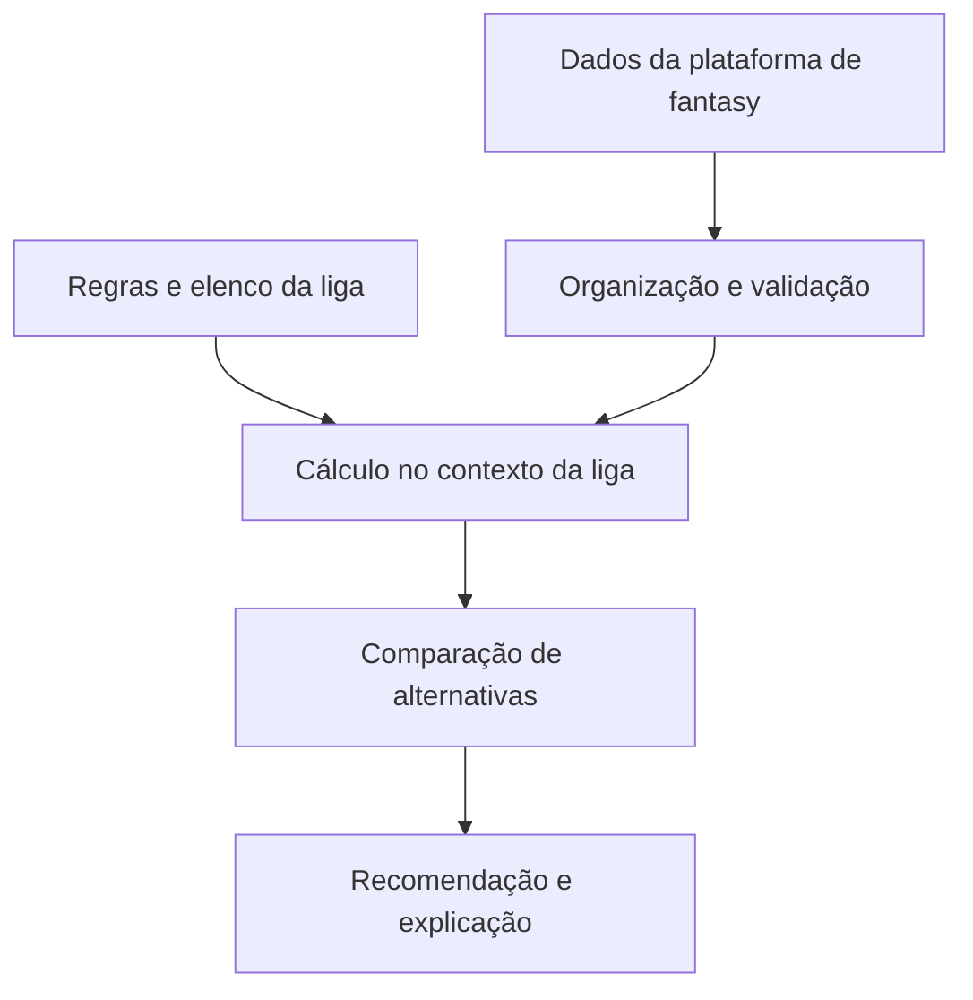

# Yardline | Visão técnica do problema de produto

[Estudo de caso](yardline.md) · [Demonstração guiada](yardline-demonstracao.md)

Esta é uma visão conceitual das responsabilidades necessárias para explicar o produto. Não é um mapa de deploy, uma auditoria do código privado ou uma afirmação de que cada etapa já foi implementada e validada.

## Contratos que importam

| Responsabilidade | Pergunta a responder na implementação |
| --- | --- |
| Identificação | O jogador e o elenco correspondem à liga escolhida? |
| Atualização | O dado está disponível e suficientemente atualizado para a decisão? |
| Regras | A pontuação considera o formato da liga e seus bônus? |
| Disponibilidade | O jogador está disponível no waiver daquela liga? |
| Explicação | O texto é sustentado pelos números e pelo contexto exibidos? |
| Falhas | A interface distingue falta de dado de um valor zero? |

## Decisões a demonstrar em uma avaliação técnica

Uma apresentação convincente pode acompanhar uma decisão do início ao fim: entrada, regra aplicada, resultado e explicação. O roteiro deve usar uma liga própria e preservar dados de outras pessoas.

Para discutir evolução, vale explicar como separar provedores de dados das regras de negócio, tratar indisponibilidade e testar pontuações com fixtures identificadas. ESPN e Yahoo continuam objetivos de expansão, não integrações apresentadas como entregues neste caso.

## Limite público

O repositório de código permanece privado. Esta visão não divulga credenciais, dados de liga, configurações, endpoints internos ou infraestrutura. Evidências de uso e acurácia só devem ser acrescentadas quando medidas.
